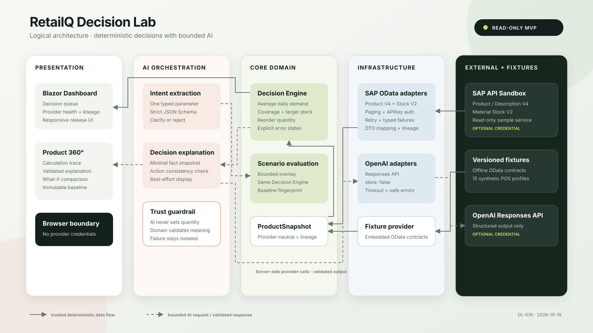

# Architecture

This document describes the implementation as released for DL-07A. It intentionally stays at system and module level; the source code remains the class-level reference.

## System boundaries

RetailQ Decision Lab is a modular monolith running as one ASP.NET Core process.

| Boundary | Owned responsibility | Explicitly outside the boundary |
|---|---|---|
| Blazor presentation | dashboard, Product 360°, data lineage, AI states and scenario comparison | provider credentials and raw external payloads |
| Core domain | product snapshot, deterministic decision, immutable scenario overlay, validation limits and baseline fingerprint | SAP DTOs, HTTP and model-specific JSON |
| Integration infrastructure | SAP OData transport/contracts/mapping, embedded fixtures and OpenAI adapters | UI state and authority over order quantity |
| SAP sandbox | read-only Product V4, Product Description V4 and Material Stock V2 sample APIs | productive tenant behavior and POS demand |
| OpenAI Responses API | structured explanation and bounded intent extraction | access to SAP, order execution and trusted calculations |

The browser communicates only with the Blazor server and the small same-origin read/evaluation surface. AI services have no public HTTP routes. All external credentials stay in server configuration.

## Logical data flow

### Product and stock flow

1. At startup, the composition root selects exactly one `IRetailDataProvider` mode.
2. Fixture mode parses embedded Product OData V4 and Material Stock OData V2 JSON. Sandbox mode performs the equivalent read-only HTTP calls and follows their paging links.
3. `SapProductMapper` converts provider DTOs to the Core `ProductSnapshot` model and records master-data, stock and sales provenance.
4. The Decision Engine consumes only the normalized snapshot. It never sees OData envelopes, HTTP clients or API keys.
5. Blazor renders the provider status, normalized facts, formula inputs and decision result.

Fixture mode uses 15 deterministic product profiles. Sandbox products receive sales history only where `Sap:DemoProductMappings` contains an explicit mapping; otherwise the decision is correctly not evaluable.

### Deterministic decision flow

For a valid 14-day history, the engine calculates average daily demand, stock coverage, target stock and projected arrival stock. Reorder quantity is `max(0, target stock - available stock)`. Missing stock/history and invalid values produce explicit non-evaluable or data-error results rather than guessed values.

### Explanation flow

1. A completed decision is reduced to an immutable `DecisionSnapshot`.
2. The server requests a strict explanation schema from the Responses API with storage disabled.
3. `DecisionResponseValidator` compares the result with the snapshot, allowed driver codes and the calculated action.
4. Only a valid explanation is displayed. The deterministic quantity has already been calculated and cannot be changed by this response.

### What-if flow

1. Natural language leaves the server only for intent extraction.
2. The model can return one typed parameter: lead-time delta, demand percentage or stock delta.
3. Domain validation enforces supported status, one parameter, integer constraints where required, bounds and non-negative resulting stock.
4. A temporary overlay is passed to the same Decision Engine; the baseline product remains immutable.
5. A baseline fingerprint rejects stale comparisons. Explanation of the simulated result is best effort and does not invalidate the numeric comparison when the provider fails.

## Security and AI trust boundary

The trust boundary is intentionally narrower than the language-model schema:

- SAP and OpenAI keys are supplied through environment variables or .NET User Secrets and never sent to the browser.
- Checked-in configuration contains endpoints and operational defaults only.
- SAP access is GET-only. The application exposes no purchase-order write path.
- The LLM sees a minimal decision snapshot or a scenario question, not credentials or raw SAP payloads.
- JSON Schema constrains syntax; domain validators independently constrain meaning.
- The model cannot write to `ProductSnapshot`, select a provider, alter a baseline fingerprint or call the Decision Engine directly.
- CSP, frame denial, content-type protection, referrer policy and permissions policy reduce browser attack surface.
- Public AI REST endpoints are deliberately not mapped in the MVP.

## Failure handling

| Failure | Implemented behavior |
|---|---|
| SAP authentication, network or contract failure | typed failure category, visible provider state, no implicit fixture fallback |
| Material Stock failure after products load | partial sandbox state; products remain visible without invented stock or recommendation |
| Incomplete stock or 14-day sales data | deterministic `NotEvaluable` decision |
| OpenAI key missing | isolated not-configured state; core application remains functional |
| LLM timeout, HTTP error or malformed/unsafe output | explanation or scenario request fails safely; baseline decision survives |
| Unsupported or ambiguous scenario | unsupported or clarification state; no calculation mutation |
| Stale browser baseline | fingerprint conflict requests a refresh instead of comparing unlike snapshots |
| User cancellation | cancellation propagates through asynchronous provider orchestration |

## Architectural trade-offs

### Why a modular monolith?

The UI, rule evaluation and integrations are one deployable process but separated by project and interface boundaries. This keeps local reproduction simple and preserves the option to extract an integration later. Independent service deployment would add networking and operational failure modes without an MVP requirement.

### Why no message queue?

Current interactions are user-driven reads and short request/response calculations. There is no asynchronous order workflow, event fan-out or durable command requirement. A queue would not improve the demonstrated flow.

### Why no vector database?

All grounding data is structured and small. Decisions use explicit numeric facts, while model output is constrained JSON. Semantic retrieval would add a trust and maintenance surface without a supporting use case.

### Why no productive SAP write integration?

The prototype demonstrates transparent decision support, not autonomous procurement. Keeping SAP read-only avoids accidental business transactions and leaves authorization, approval workflows, idempotency and audit requirements for a production design.

### Why embedded fixtures?

Versioned fixtures make OData parsing, mapping and business decisions reproducible without credentials or external uptime. Their visible source label prevents them from being mistaken for a successful remote call.

## Deployment view and future production work

The present target is local execution on .NET 10. A production evolution would require authentication and authorization, tenant isolation, durable storage, secrets management, telemetry with redaction, rate limiting, provider policy review, self-hosted/static asset review, CI security scanning and an approved SAP write/approval design. These are deliberately not implied by the portfolio prototype.
